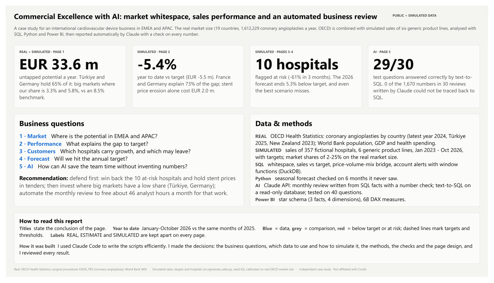
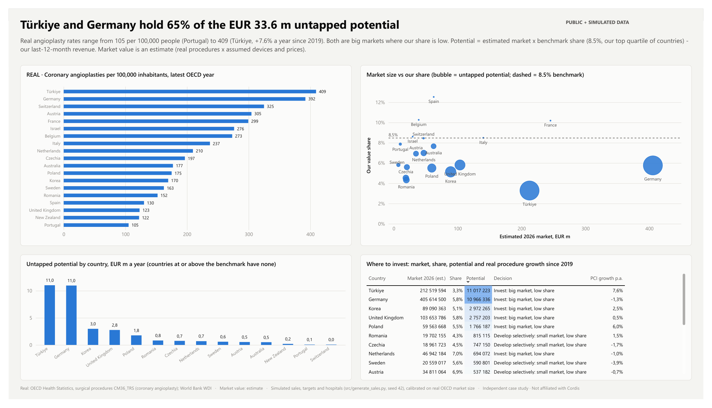
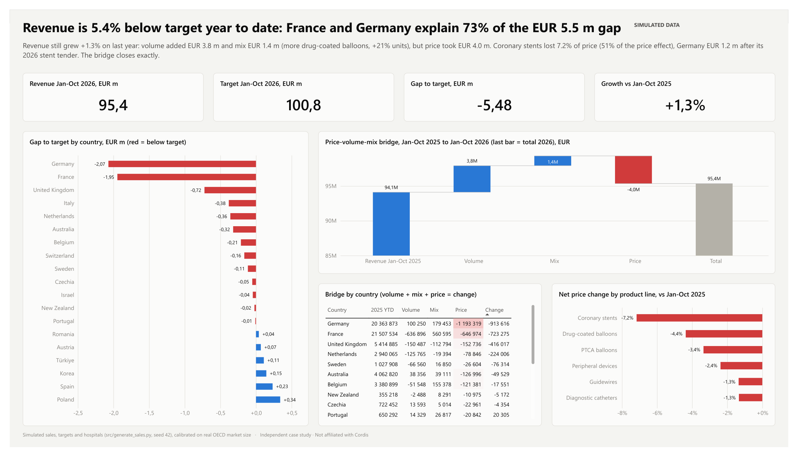
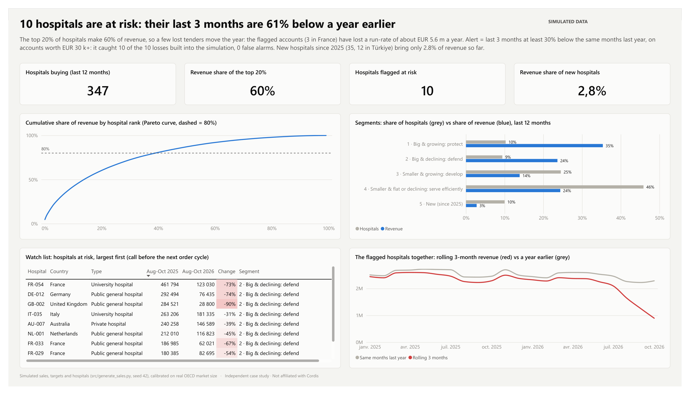
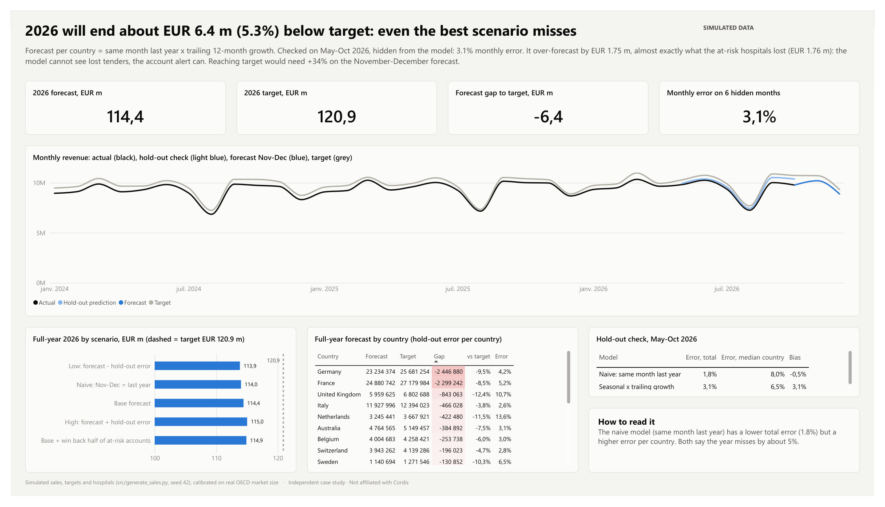
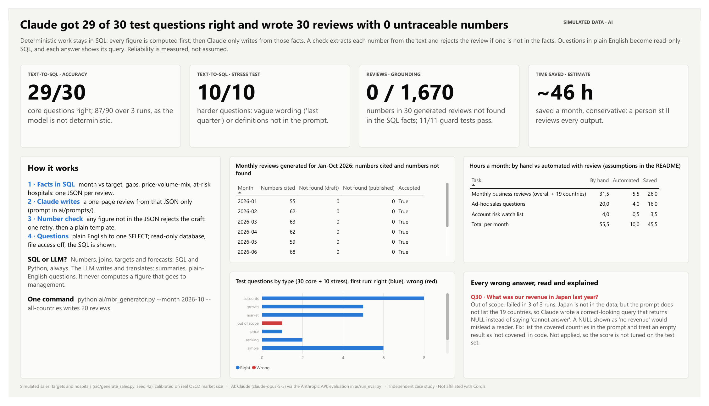

# Commercial Excellence with AI: market whitespace, sales performance and an automated business review

A case study for an international cardiovascular device business (EMEA and APAC), built for a *Commercial Excellence Analyst - AI & Analytics* application.
**Independent work, not affiliated with Cordis.** The market size is **real** (OECD procedure counts). Sales, targets and hospitals are **simulated** and labelled as such: Cordis is a private company and publishes no sales detail. No Cordis product names, logos or data are used.

## Questions and answers
Data as of October 2026; "year to date" = January-October 2026 vs the same months of 2025.

| # | Question | Data | Answer |
|---|---|---|---|
| 1 | Where is the potential in EMEA and APAC? | OECD angioplasty counts, 19 countries (real) + simulated sales | **EUR 33.6 m** of untapped potential a year (market x benchmark share - our revenue). **Türkiye and Germany hold 65%** of it: Türkiye has the highest procedure rate (409 per 100,000 people, +7.6% a year since 2019) but our share is 3.3%; Germany is the largest market in value, with a 5.8% share. The benchmark is 8.5%. |
| 2 | What explains the gap to target? | Simulated | Revenue is **5.4% below target** (EUR -5.5 m) but **+1.3%** on last year. **France and Germany explain 73%** of the gap. Price-volume-mix bridge: volume +EUR 3.8 m, mix +EUR 1.4 m, **price -EUR 4.0 m**, half of it from coronary stents (-7.2% net price). |
| 3 | Which hospitals carry growth, and which may leave? | Simulated | The top 20% of hospitals make **60%** of revenue. **10 hospitals are at risk**: their last 3 months are 61% below a year earlier, a lost run-rate of about EUR 5.6 m a year. The alert caught all 10 losses built into the simulation, with no false alarm. |
| 4 | Will we hit the annual target? | Simulated | **No: about EUR 114.4 m vs EUR 120.9 m (-5.3%)**. The forecast was checked on 6 hidden months (3.1% error). The best scenario still misses by 4.8%, and reaching target would need +34% on the November-December forecast. |
| 5 | How can AI save time without inventing numbers? | Simulated + Claude API | 30 reviews written by Claude (10 months + 20 October scopes) cite **1,670 numbers, 0 not traceable to SQL**. Text-to-SQL: **29/30** core questions right (87/90 over 3 runs, the one miss is an out-of-scope question answered with a silent NULL) and **10/10** harder questions. About **46 h of analyst time saved a month** (estimate with a human review kept). |

## The report
Six pages, one question each, with the conclusion in the title. Full report: [docs/CommercialExcellenceCaseStudy.pdf](docs/CommercialExcellenceCaseStudy.pdf).
Example of a generated review: [docs/mbr/MBR_2026-10.md](docs/mbr/MBR_2026-10.md), and one per country, e.g. [France](docs/mbr/MBR_2026-10_FRA.md). The October run (overall + 19 countries, one command) cited 1,003 numbers, all found in the SQL facts ([run log](docs/mbr/run_2026-10.csv)).



| | |
|---|---|
|  |  |
|  |  |
|  | |

## The AI layer (`ai/`)
**Rule: every number comes from SQL; the model only writes and translates.**

| Step | What happens | File |
|---|---|---|
| 1. Facts | SQL on a read-only DuckDB database computes the month and year-to-date vs target, the gaps by country and product line, the price-volume-mix bridge and the at-risk hospitals. The result is one JSON document per review, with numbers already rounded for display. | `ai/mbr_generator.py` |
| 2. Writing | Claude (`claude-opus-5-5`) writes a one-page review **from that JSON only**. It must not add, round or convert any number. | `ai/prompts/mbr_system.md` |
| 3. Number check | Every number in the text is extracted and looked up in the JSON. If one is missing, Claude retries once with the list of bad numbers. If it fails again, the review is rejected and a plain template is used. | `ai/common.py` |
| 4. Questions in plain English | Claude turns the question into one DuckDB query (structured output). A guard accepts only a single SELECT. The database is opened read-only with file and network access disabled. The answer is printed with the SQL it came from. | `ai/text_to_sql.py`, `ai/prompts/text_to_sql_system.md` |

```bash
.venv\Scripts\python ai/mbr_generator.py --month 2026-10                  # one review
.venv\Scripts\python ai/mbr_generator.py --month 2026-10 --all-countries  # overall + 19 country reviews
.venv\Scripts\python ai/text_to_sql.py "Which country missed target most in Q3?"
```
Without an API key, `--offline` (or a missing key) produces the same review from a template, so the pipeline always runs.

**Evaluation** (`ai/run_eval.py`, results in `ai/eval_*.csv`):
- **Text-to-SQL, 30 core questions.** Each one has a gold answer written by hand in SQL (`ai/eval_questions.csv`). A generated query counts as correct when its result has the same rows and values (0.1% tolerance). Each question is asked **3 times**, because the model is not deterministic. Scoring is strict: an out-of-scope question (Japan) must answer "cannot answer"; a silent NULL counts as wrong.
- **10 stress questions** with vague wording ("last quarter", "this year") or definitions the prompt does not give.
- **Grounding**: one review per month, January-October 2026; numbers cited vs numbers not found in the facts.
- **Guards**: 11 tests. A changed figure or an invented statistic must be rejected. DROP, UPDATE, multi-statement, COPY, ATTACH and file-reading queries must be blocked by the guard *and* by the read-only connection.
- **Wrong answers are read and explained** in `ai/eval_error_analysis.csv` and shown on page 5.

**When to use SQL and when to use an LLM.** Use SQL or Python for anything that is a number: aggregates, targets, bridges, forecasts. They are deterministic, testable and reproducible. Use the LLM for language: writing a summary from computed facts, and translating a question into SQL that a person can read and check. The LLM never computes a figure that goes to management, and its outputs are checked automatically before a person reviews them.

**Time saved** (`ai/time_saving.py`, assumptions written next to each number): monthly reviews for 20 scopes, ad-hoc questions and the risk watch list. Time spent by hand is compared with time spent automated, review included. Questions the AI gets wrong in the test set are counted as fully manual.

**Security.** The API key is read from the `ANTHROPIC_API_KEY` environment variable, loaded from a local `.env` file that `.gitignore` excludes (`.env.example` shows the format). The key is never in the code or in the repository. Only aggregated, simulated sales data are sent to the API: no patient data.

## How it is built
```
data/raw/        OECD + World Bank downloads, with URLs and dates (download_log.csv)
data/clean/      countries (real), market size (estimate), simulated sales, targets, hospitals, answer key
data/output/     every number shown in the report (SQL results, notebook outputs, kpis.csv, AI evaluation)
sql/             DuckDB: 01 market size, 02 sales vs target, 03 price-volume-mix bridge, 04 account risk, 05 forecast inputs
notebooks/       analysis.ipynb: whitespace, bridge checks, segments, alert scored vs answer key, forecast with hold-out
ai/              mbr_generator.py, text_to_sql.py, run_eval.py, eval_questions.csv, eval_results.csv, prompts/
src/             get_public_data.py, generate_sales.py, run_sql.py, build_notebook.py, build_semantic_model.py, build_report_pages.py
powerbi/         Power BI project (.pbip: semantic model in TMDL + report in PBIR), .pbix, theme
docs/            report PDF, one screenshot per page, generated monthly reviews (docs/mbr/)
```
**Rigour points**
- Simulated sales are calibrated on the real market: unit shares of 2-25% by country and product line, printed by the generator.
- The price-volume-mix bridge closes exactly: `closure_check` = 0 in SQL, and the notebook checks it with an `assert`.
- Account trends use a complete hospital x month grid, so a month without orders counts as 0 instead of disappearing; window functions compute rolling 3-month revenue and `LAG` 12 months.
- The forecast is validated on May-October 2026, hidden from the model, and compared with a naive baseline. It over-forecast by EUR 1.75 m, almost exactly what the at-risk hospitals lost (EUR 1.76 m). A statistical forecast cannot see lost tenders; the account alert can.
- Every number in the report titles comes from `data/output/kpis.csv` or `ai/eval_summary.csv`, through `build_report_pages.py`.

**Power BI model (star schema):** facts `Sales` (month x hospital x product line), `Targets`, `Market`; dimensions `Date`, `Country` (region, real procedures, population), `Product`, `Account` (hospital, segment, risk flag); analysis tables from SQL, the notebook and the AI evaluation; 68 DAX measures in 7 display folders (sales, targets, market, price-volume-mix, accounts, forecast, AI evaluation).

**From Power BI to Oracle Analytics Cloud.** The logic carries over unchanged. The star schema becomes the OAC semantic model: the physical layer holds the same tables; the logical layer holds the facts, the dimensions and the hierarchies (Region > Country, Year > Quarter > Month). Each DAX measure becomes a logical column defined once (for example, Gap to Target = Revenue - Target). The AI layer only needs SQL access to the same tables.

## Reproduce
```bash
python -m venv .venv
.venv\Scripts\pip install -r requirements.txt
.venv\Scripts\python src/get_public_data.py       # REAL data: OECD + World Bank -> data/raw, data/clean
.venv\Scripts\python src/generate_sales.py        # SIMULATED sales (seed 42)
.venv\Scripts\python src/run_sql.py               # DuckDB database + sql/*.sql -> data/output
.venv\Scripts\python src/build_notebook.py
.venv\Scripts\jupyter nbconvert --to notebook --execute --inplace notebooks/analysis.ipynb
copy .env.example .env                            # then put your Anthropic API key in .env (optional)
.venv\Scripts\python ai/run_eval.py               # AI evaluation (uses the API)
.venv\Scripts\python ai/time_saving.py
.venv\Scripts\python src/build_semantic_model.py  # TMDL model
.venv\Scripts\python src/build_report_pages.py    # PBIR pages
```
Power BI: open `powerbi/CommercialExcellence.pbix` (data included), or the `.pbip` project (readable source files): set the `DataFolder` parameter to your `data\` folder if needed, and refresh.

## Limits
- Sales, targets and hospitals are simulated: they demonstrate methods, not Cordis's performance. Because they follow the model's own structure, real forecast errors and alert results would be worse.
- Market value is an estimate (real procedure counts x assumed devices and prices). Peripheral devices are sized with a proxy, not an OECD count.
- Japan and other large APAC markets have no OECD angioplasty series and are out of scope.
- The number check proves that each figure exists in the facts, not that it is attached to the right country or month. A human review stays in the loop.
- The text-to-SQL test set uses well-defined questions with definitions in the prompt. Real questions are vaguer, which is why the stress set and the "cannot answer" rule exist.
- Time savings are estimates based on stated assumptions, not measurements.
